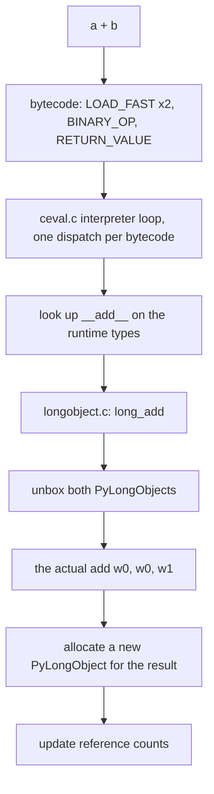

# 01 — `a + b` in three languages

```
make run LESSON=01        # C, hand-written assembly, then Python
make asm LESSON=01        # the assembly clang generates
make asm LESSON=01 DIFF=1 # -O0 beside -O2
```

## The whole lesson in one comparison

Adding two integers is the smallest useful thing a computer does. Here is what
it costs in each language on this machine:

| | Instructions | Time | Cycles |
|---|---|---|---|
| C, inlined | 1 (`add w0, w0, w1`) | 0.32 ns | 1.0 |
| C, through a call | 3 (`bl`, `add`, `ret`) | 0.95 ns | 3.0 |
| Hand-written ARM64 | 3, identical | 0.95 ns | 3.0 |
| Python, small ints | ~4 bytecodes, hundreds of machine instructions | ~29 ns | ~90 |

That last row is the "100x" you were after, and it is roughly right.

## Why C's version is one instruction

```c
int add(int a, int b) { return a + b; }
```

becomes

```asm
_add:
    add     w0, w0, w1
    ret
```

The compiler knew three things before the program ran: both operands are 32-bit
integers, they are already in registers `x0` and `x1` because that is where the
calling convention puts them, and the result belongs in `x0`. Knowing all that,
there is nothing left to do but the arithmetic.

`w0` is the low 32 bits of the 64-bit register `x0`. `ret` jumps to the address
in `x30`, the link register, which `bl` wrote when the caller jumped here.

Compare [`add.S`](add.S), which is that function written by hand. It produces
identical timings because it is identical code.

## Why Python's version is not



Every box except one is work C never does. CPython cannot know that `a` and `b`
are integers until it looks, and it must look every single time, because the
next call might pass strings or lists or a class with a custom `__add__`.

Then the result needs somewhere to live. In C it lives in a register. In Python
it must be a heap-allocated object with a type pointer and a reference count,
because everything in Python is an object.

## Things worth noticing when you run it

**Small integers are cheaper than large ones.** CPython preallocates the
integers from -5 to 256, so `2 + 3` reuses an existing object instead of
allocating. Watch the `~1e18` row cost more.

**Python 3.11 and later cheat, successfully.** The interpreter watches which
bytecodes run hot and rewrites them in place: a `BINARY_OP` that has only ever
seen integers becomes `BINARY_OP_ADD_INT`, which skips the type lookup and goes
straight to the integer path. It re-checks the types and bails out if you ever
pass something else. This is why the measured cost is lower than the list of
steps above suggests, and why the same script gets faster on newer Pythons.

**The dependent chain is exactly 1.00 cycles/op.** That is not a coincidence or
a rounding artifact. Each `add` must wait for the previous one's result, so the
CPU can only retire one per cycle no matter how many spare adders it has. When
the chains are independent that floor disappears, and the same instruction gets
cheaper. Lesson 06 is about that gap.

## Which Python am I measuring?

The script prints `sys.executable`. This matters more than it sounds: if you use
pyenv or conda, your shell's `python3` and `make`'s `python3` can be different
builds with meaningfully different performance. To compare two:

```
make run LESSON=01 PYTHON=/opt/homebrew/bin/python3
make run LESSON=01 PYTHON=$(pyenv which python3)
```

## Exercises

1. Run `make asm LESSON=01 DIFF=1`. At `-O0` the function spills both arguments
   to the stack and reads them back. At `-O2` it does not. Count the memory
   accesses in each.
2. Change `int` to `double` in `add_called` and dump the assembly again. Which
   register file does it use now, and what replaced `add`?
3. Change it to `long`. Does `w0` become `x0`? Why?
4. In `add.py`, add a benchmark for `a + b` where `a` is a `float`. Is it faster
   or slower than the integer version, and can you explain the direction?

## Further reading

Full list with ISBNs: [README.md](../README.md#resources).

- CS:APP 3e, 3.1–3.5. ISBN 978-0-13-409266-9.
- Anthony Shaw, *CPython Internals*. ISBN 978-1-77509-334-3.
- Ned Batchelder, [Facts and myths about Python names and values](https://nedbatchelder.com/text/names.html)
- Victor Skvortsov, [How the CPython VM works](https://tenthousandmeters.com/blog/python-behind-the-scenes-1-how-the-cpython-vm-works/), [How Python integers work](https://tenthousandmeters.com/blog/python-behind-the-scenes-8-how-python-integers-work/)
- CPython `Python/ceval.c`, `Objects/longobject.c`
- [PEP 659](https://peps.python.org/pep-0659/)
- Matt Godbolt, [What Has My Compiler Done for Me Lately?](https://www.youtube.com/watch?v=bSkpMdDe4g4)
